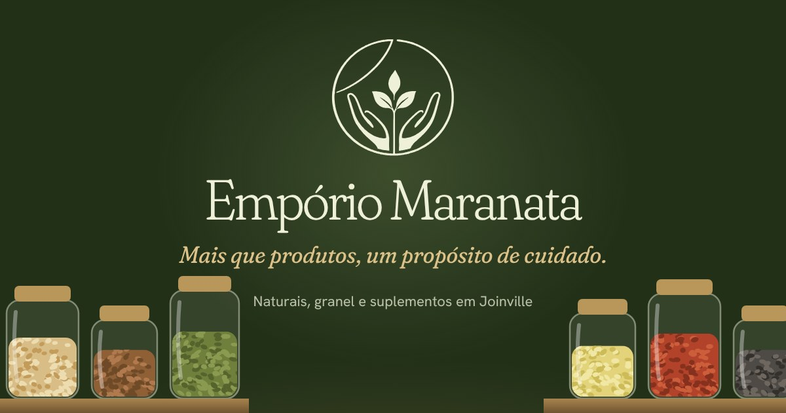
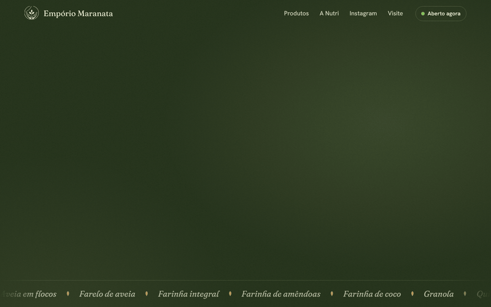
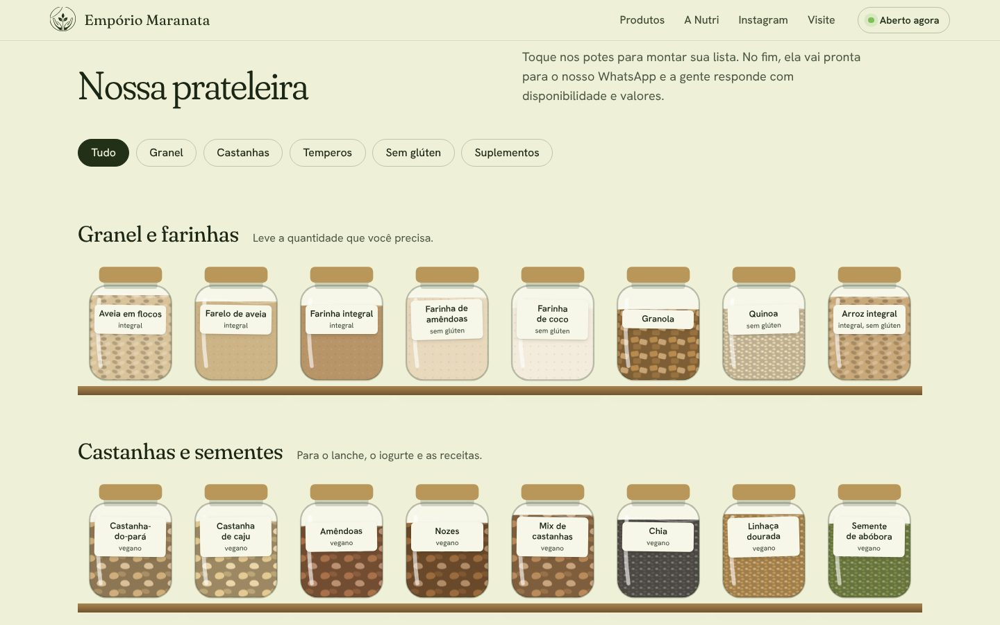
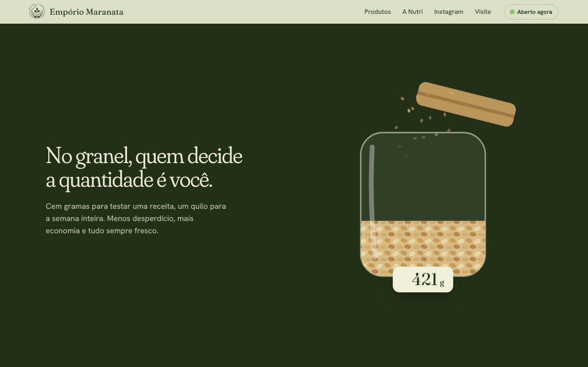
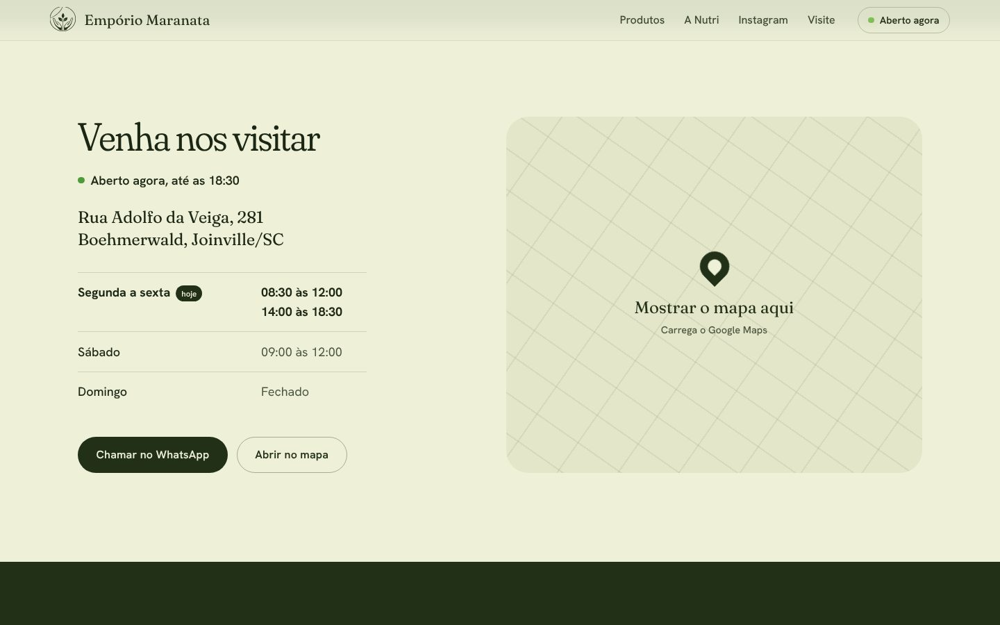
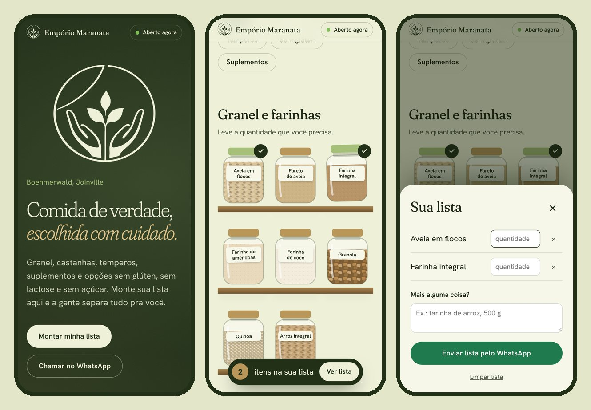

<div align="center">



# Empório Maranata

**Site da loja de produtos naturais do Boehmerwald, em Joinville/SC**

[**emporiomaranata.vercel.app**](https://emporiomaranata.vercel.app)


<br>


[](https://github.com/LocatelliBryann/EmporioMaranata/actions/workflows/qualidade.yml)

</div>

<br>

<p align="center">
  
</p>

## Sobre o projeto

O Empório Maranata é uma loja de bairro com granel, castanhas, temperos, suplementos e opções sem glúten, sem lactose e sem açúcar. A dona é nutricionista. Com as vendas em queda e um Instagram parado, a loja precisava de um endereço próprio na internet: algo que aparecesse no Google, passasse a mesma confiança do balcão e transformasse visita em pedido.

O site resolve isso com uma ideia simples: **a prateleira da loja vira o catálogo**. Cada produto é um pote de vidro desenhado; o cliente toca nos potes, monta uma lista e envia pronta para o WhatsApp da loja. Sem cadastro, sem carrinho, sem preços desatualizados. A loja responde com disponibilidade e valores, como já fazia no balcão.

## Destaques

<table>
  <tr>
    <td width="50%"></td>
    <td width="50%"></td>
  </tr>
  <tr>
    <td><b>Prateleira de potes.</b> 40 potes gerados em SVG a partir de um arquivo de dados. O conteúdo de cada um (grão, pó, semente, castanha, erva, cápsula, líquido) é uma textura procedural com tons calculados a partir de uma única cor.</td>
    <td><b>Granel pela rolagem.</b> Seção fixa em que o pote enche, a tampa abre, os grãos caem e a balança marca 100 g, 250 g, 500 g e 1 kg conforme o usuário rola a página.</td>
  </tr>
  <tr>
    <td width="50%"></td>
    <td width="50%"></td>
  </tr>
  <tr>
    <td><b>Quem cuida da loja.</b> Apresentação da nutricionista em moldura de arco, como a janela de um empório.</td>
    <td><b>Horário ao vivo.</b> "Aberto agora, até as 18:30" e o dia de hoje destacado, calculados no fuso de Joinville. O mapa só carrega quando o usuário pede.</td>
  </tr>
</table>

<p align="center">
  
</p>

### Funcionalidades
- **Lista de pedido pelo WhatsApp:** itens, quantidades e observações viram uma mensagem pronta (`wa.me`). A lista fica salva no aparelho (`localStorage`).
- **Logo animada:** a logo original foi vetorizada a partir de um PNG de 640 px. O símbolo é dividido em partes (aro, mãos, caule, folhas) que se desenham e brotam na abertura.
- **Feed do Instagram:** função serverless que busca as três últimas publicações (Behold ou Instagram API), com cache na borda. Sem configuração, mostra os vídeos da própria loja.
- **SEO local:** dados estruturados `Store` com endereço, telefone e horário, Open Graph com banner próprio, sitemap e canonical.
- **Página 404** no tom da marca: *"Este pote está vazio."*

## Design

A identidade parte da logo existente (mãos acolhendo um broto, em creme sobre verde) e de um objeto que todo mundo reconhece num empório: **o pote de vidro do granel**.

| | Cor | Uso |
|---|---|---|
|  | `#223018` Mata | Fundo da logo; seções escuras, botões |
|  | `#EEF0D8` Creme do broto | Fundo claro, tirado do próprio símbolo |
|  | `#B9975B` Ouro velho | Tampas dos potes, detalhes |
|  | `#DCC28A` Ouro claro | Segunda linha do título, assinatura |
|  | `#A6C07A` Broto | Tampa do pote selecionado, acentos |
|  | `#8A6A3E` Madeira | Tábuas da prateleira |

**Tipografia:** [Fraunces](https://fonts.google.com/specimen/Fraunces) nos títulos, usando os eixos variáveis `SOFT` (cantos arredondados, orgânicos) e `WONK` (itálico com personalidade), e [Hanken Grotesk](https://fonts.google.com/specimen/Hanken+Grotesk) no texto. As duas fontes são auto-hospedadas, sem chamadas ao Google Fonts. A escala tipográfica é 4:3.

**Movimento:** cada animação tem um significado na loja: a logo brota, os potes são *colocados* na prateleira, o pote do granel enche e a contagem de itens pula quando algo entra na lista. Tudo respeita `prefers-reduced-motion`.

## Engenharia

| | |
|---|---|
| **Stack** | HTML, CSS e JavaScript (ES modules), sem framework e sem etapa de build |
| **Hospedagem** | Vercel: estático na CDN e uma função Node em `api/` |
| **Peso** | ~100 KB de HTML (com a logo animada embutida), ~57 KB de CSS + JS sem minificar, ~300 KB de fontes em WOFF2 |
| **Segurança** | CSP restritiva (`script-src 'self'`), HSTS, `X-Frame-Options`, `Permissions-Policy`, `Referrer-Policy` |
| **Privacidade** | Sem cookies, sem analytics, sem formulários. O Google Maps só carrega com um clique e a lista só sai do aparelho quando o usuário toca em enviar |
| **Acessibilidade** | HTML semântico, link "pular para o conteúdo", foco visível, `aria-pressed` nos potes, painel da lista como `dialog` com Esc, contraste AA |
| **Qualidade** | GitHub Actions valida o HTML ([html-validate](https://html-validate.org)), a sintaxe do JS e os JSON a cada push |

### Estrutura

```
.
├── index.html               página única (logo animada embutida)
├── 404.html
├── api/
│   └── instagram.js         função serverless: últimas publicações do Instagram
├── assets/
│   ├── css/site.css         tokens de design, layout e animações
│   ├── js/produtos.js       catálogo, horário e contatos (dados editáveis)
│   ├── js/site.js           prateleira, lista, horário ao vivo, granel, feed
│   ├── fonts/               Fraunces e Hanken Grotesk (OFL)
│   ├── img/                 logo vetorizada, foto, favicons, banner OG
│   └── video/               vídeos da loja (reserva do feed)
├── scripts/
│   ├── vetorizar-logo.py    PNG → SVG com potrace (símbolo em partes)
│   └── gerar-imagens.py     favicons e banner Open Graph via Playwright
├── docs/                    manual de manutenção e imagens deste README
├── vercel.json              cabeçalhos de segurança e cache
└── .github/workflows/       validação automática
```

## Rodando localmente

```bash
git clone https://github.com/LocatelliBryann/EmporioMaranata.git
cd EmporioMaranata
npm run serve        # http://localhost:8000 (o feed cai nos vídeos)
npm run dev          # com a função do Instagram, via Vercel CLI
npm run validar      # mesma checagem do CI
```

Para editar produtos, horário, foto, feed do Instagram ou domínio, veja o [**manual de manutenção**](docs/MANUTENCAO.md).

## Próximos passos

- [ ] Domínio `emporiomaranata.com.br`
- [ ] Feed real do Instagram (Behold)
- [ ] Fotos reais dos produtos mais vendidos no lugar de alguns potes
- [ ] Seção "Produto da Semana" alimentada pelo mesmo arquivo de dados

## English summary

A one-page website for **Empório Maranata**, a neighborhood natural-foods store in Joinville, Brazil. The store's shelf *is* the catalog: 40 procedurally textured SVG jars that visitors tap to build a shopping list, sent as a ready-made WhatsApp message (no prices, no checkout). Highlights include the store's raster logo vectorized with potrace and animated part by part, a scroll-driven bulk-food jar that fills while a scale counts grams, a live "open now" status in the store's time zone, an Instagram feed via a Vercel serverless function with a fallback, local-SEO structured data, a strict CSP and no cookies. Vanilla HTML/CSS/JS, zero runtime dependencies, Lighthouse 99/100/100/100.

## Licença e créditos

O **código** está sob a [licença MIT](LICENSE). O nome, a logo, o slogan, as fotos e os vídeos do Empório Maranata pertencem à loja e **não** podem ser reutilizados. As fontes seguem a SIL Open Font License.

Projeto, design e desenvolvimento por **[Bryann Locatelli](https://github.com/LocatelliBryann)**.
